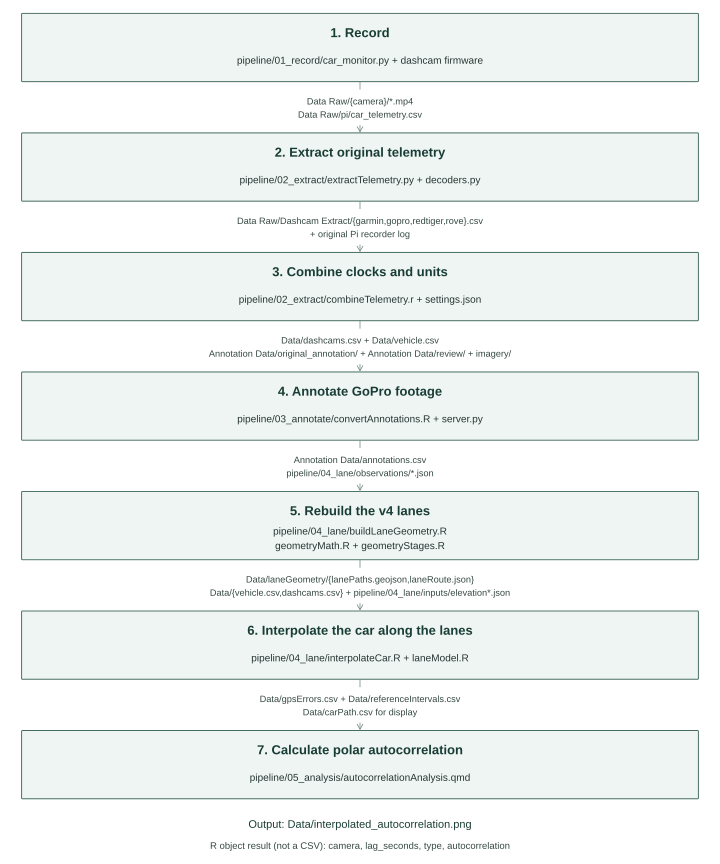
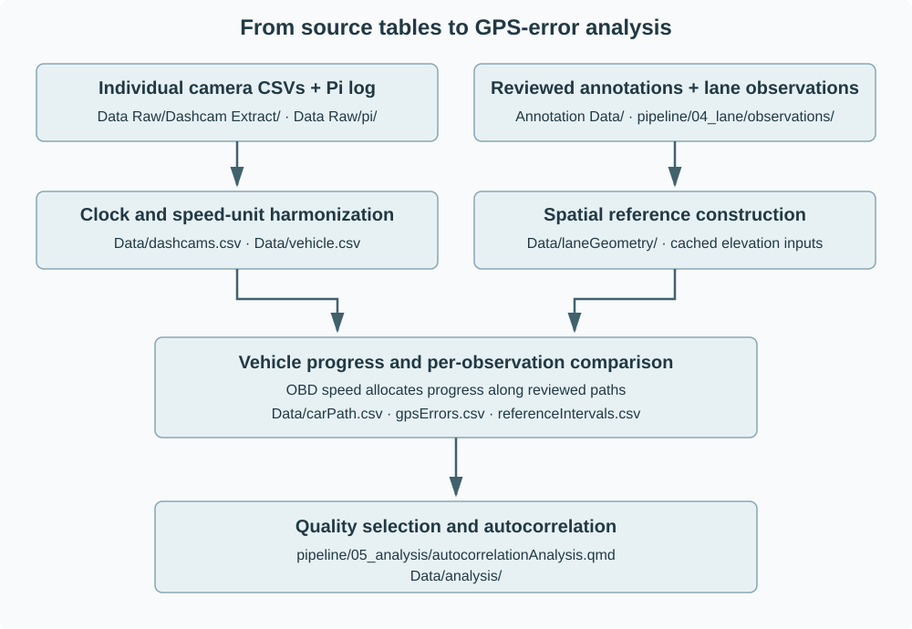

## Abstract

This dataset combines positioning observations from four vehicle-mounted cameras with vehicle telemetry and a manually annotated spatial reference for an urban drive in Lincoln, Nebraska. The recording, acquired on 13 July 2026, comprises three laps and includes 51,460 camera positioning observations at nominal frequencies of 1 or 10 Hz. Vehicle speed, engine speed, throttle position, and two trailer connector electrical signals are retained on a common time axis. A set of 375 manually placed annotations and recorded lane observations defines 374 reference intervals. Vehicle progress between annotations is reconstructed from integrated on-board diagnostic speed along modeled lane paths, with cached terrain elevations used for distance adjustment. The data include original format extractions, synchronized observations, annotation records, per-observation error distance and direction, and separate interval-quality flags. 

## Background & Summary

Positioning observations recorded by consumer cameras can provide a time indexed account of vehicle movement alongside video. Comparing these observations requires more than placing several tracks on a map. Each device stores telemetry differently, sampling rates differ, recording files are split into clips, and vehicle mounted recorders may use clocks that do not agree. A second difficulty is the construction of a reference trajectory against which the positions can be evaluated. A reference obtained by averaging the receivers being evaluated would share their errors and would not provide an independent spatial comparison, as obstructions that cause GPS errors could cause similar errors across separate devices.

Four cameras recorded the same drive, and a separate vehicle logger collected speed and other telemetry. Recorded lane observations supplied the spatial constraints between those annotations, and vehicle speed supplied the timing of progress along each reference path. The resulting error records remain linked to the source camera, clip, and telemetry sample.

The collection represents one vehicle, one recording session, and three laps of a repeated urban route. The files distinguish three kinds of information: observations reported by devices, positions manually interpreted from video and imagery, and positions calculated using the vehicle's intended path and odometry.

Section not complete

## Methods

### Study design and recording context

The drive took place in Lincoln, Nebraska, on 13 July 2026 using a 2023 Toyota 4Runner SR5. The common analysis origin was 10:28:00 UTC, equivalent to 05:28:00 Central Daylight Time. Three laps were annotated. The final annotation occurred at 3952.47 s after the origin, corresponding to approximately 65 min 52 s of reference coverage. The extraction window extended to 11:40 UTC to include the relevant end-of-drive camera records; this padded limit is not the duration of the annotated route.

### Instrumentation and vehicle telemetry

The drive used four dashcams Garmin Dash Cam X310, REDTIGER F7N Touch, ROVE R2-4K Dual, and GoPro HERO13 Black. The four cameras were mounted near the rear-view mirror. A photograph of the installed cameras, with each device labeled and its viewing direction identified, remains to be added (Figure 1 placeholder). The nominal GPS extraction interval is 1 s for Garmin, REDTIGER, and ROVE, and 0.1 s for GoPro HERO13 Black. These are telemetry sampling intervals; they do not describe the video frame rates. Many modern dashcams save drive footage in the form of several small clips, so the footage is split originally 68 Garmin clips, two GoPro clips, 68 REDTIGER clips, and 67 ROVE clips. 

A separate Raspberry Pi logger combined on-board diagnostic (OBD-II) information with Arduino serial readings. The project hardware record identifies an OBDLink EX adapter. The logger measured engine speed, vehicle speed, and throttle position, while a separate reader received an Arduino elapsed-millisecond counter and the binary states of the yellow and green trailer connector wires. The software sampled the most recent values into a CSV at a target rate of 10 Hz. Background sensor updates and CSV logging were asynchronous, so successive rows may contain repeated sensor values. Connection flags identify whether the interfaces were connected; they do not certify that each sensor reading was newly acquired at that logging tick.

The logger converted OBD speed from kilometres per hour to miles per hour and rounded it to one decimal place before writing Speed_MPH. This recorded value was later converted to metres per second for analysis. Engine speed and throttle readings were retained alongside the electrical states. The two trailer wires carry combined brake and indicator activity. Their instantaneous binary values do not uniquely identify braking, turning, or hazard light use; the raw states were therefore preserved. The flashing activity of the tailights is described in terms of intended action (e.g. using the right blinker, activating the hazards, braking.)

### Workflow and preservation of source observations

{fig-alt="Project pipeline"}

The analysis begins with the individual camera CSVs in [Data Raw/Dashcam Extract](Data%20Raw/Dashcam%20Extract/) and the [original Pi log](Data%20Raw/pi/car_telemetry.csv). In this descriptor, these CSVs are the source observations. Clock and speed-unit harmonization produces the combined tables; reviewed annotations, spatial observations, and OBD speed then define the modeled reference trajectory and per-observation GPS errors.

### Camera input tables and retained sensor values

**Garmin Dash Cam X310.** [garmin.csv](Data%20Raw/Dashcam%20Extract/garmin.csv) contains nominally 1 Hz positions, UTC times, camera-reported speed in mph, and fix status. No acceleration or angular-velocity fields are present.

**GoPro HERO13 Black.** [gopro.csv](Data%20Raw/Dashcam%20Extract/gopro.csv) contains nominally 10 Hz GPS observations and reported speed in km/h. The acceleration columns are in m/s² and angular velocity is in rad/s; these units are explicitly identified by the recordings' sensor metadata. The retained inertial values are averages associated with GPS rows, not full-rate inertial samples. Both 2D and 3D fixes are accepted for the horizontal-position comparison. [GoPro's format documentation](https://gopro.github.io/gpmf-parser/) describes the sensor units and timing metadata.

**REDTIGER F7N Touch.** [redtiger.csv](Data%20Raw/Dashcam%20Extract/redtiger.csv) contains nominally 1 Hz GPS observations, speed in knots, and two acceleration components labeled `g (estimated)`. The X and Y columns contain the original signed integer sensor values multiplied by a provisional scale of 0.048 g per integer increment. The original integer values within the analysis window span −12 to +7 on X and −11 to +5 on Y. The Z column is blank because the recorded zero-valued field has not been established as a usable measurement.

The provisional conversion of 0.048 g per integer increment was estimated, not a manufacturer specification or a complete calibration. A single scale factor was fitted jointly to the REDTIGER X and Y acceleration values, together with axis orientation and a constant offset, using GoPro acceleration on lap 1. The fitted model was evaluated on laps 2 and 3. At a 2 s Gaussian smoothing scale, separate lap fits gave 0.04776, 0.04800, and 0.04829 g per integer increment. OBD speed changes and ROVE acceleration provided supporting comparisons, while a GPS-heading-based lateral comparison gave a lower scale.

**ROVE R2-4K Dual.** [rove.csv](Data%20Raw/Dashcam%20Extract/rove.csv) contains nominally 1 Hz GPS observations, speed in knots, and three acceleration components labeled `g`. That acceleration unit is the current decoder's interpretation; no device-specific manufacturer conversion has been verified. The retained values are averages of multiple sensor readings. The calibration limitations below apply to their use.

All four camera tables retain source clip names and within-clip sample indices. Their latitude and longitude columns are already decimal degrees. For the REDTIGER source-format attribution, the appropriate technical reference is Phil Harvey's [ExifTool QuickTime stream implementation](https://github.com/exiftool/exiftool/blob/master/lib/Image/ExifTool/QuickTimeStream.pl), which documents support for Novatek/freeGPS variants. This is a decoder reference, not a manufacturer GPS standard or evidence for the 0.048 conversion.

### Time synchronization and unit harmonization

The individual REDTIGER and ROVE CSVs report speed in knots (nautical miles per hour). Garmin reports mph, and the GoPro CSV reports km/h. The combined camera table expresses all speeds in m/s.

All synchronized observations use timeSec, the elapsed number of seconds relative to the drive origin. For a camera observation, the decoded GPS timestamp is converted to elapsed UTC time and the configured cameraClockFastSec value is subtracted. All four camera corrections are currently zero. Camera speed is converted to metres per second using 0.44704 for miles per hour and division by 3.6 for kilometres per hour, and multiplication by 1852/3600 for knots. The accepted fix labels are fix, active, 2D, and 3D.

The Pi clock had an incorrect calendar date as well as an offset. The working configuration identifies 2026-03-02 00:39:16 as a Pi-clock anchor. Raw Pi records earlier than this anchor are removed from the synchronized vehicle table, while the original log remains available.

The mapping is `timeSec = (Pi timestamp − 2026-03-02 00:39:16) − 125.2 s`, as recorded in [settings.json](settings.json). The correction is applied once, during combination. Negative timeSec values in vehicle.csv are expected and represent the retained pre-origin portion of the log. 

Combination creates a long format camera table without reducing GoPro to the sampling rate of the other cameras. readingIndex is assigned chronologically within each camera across all clips. It is distinct from sampleIndex, which is local to a source clip. The combination stage rejects duplicate camera timestamps and non-increasing synchronized vehicle times. The result is [dashcams.csv](Data/dashcams.csv) together with [vehicle.csv](Data/vehicle.csv), produced by [combineTelemetry.r](pipeline/02_extract/combineTelemetry.r).

### Video review and manual annotation

Manual annotations were created by one person viewing the dashcam footage. During the viewing, they had marked when certain actions had taken place during the drive, such as stopping at a stop sign, and recorded the predicted position of the car based on the footage, as well as a confidence value. Confidence percentages were chosen subjectively by that researcher.

The [original annotation file](Annotation%20Data/original_annotation/anno%208%2011%202026.csv) contains 375 points across three laps. Each point has a drive time, map position, lap identifier, confidence value, notes, and selected event triggers. Events include entering or leaving intersections, beginning or finishing stops, blinker activation, lane change boundaries, and turn boundaries outside intersections. A held location flag and a stop group identifier preserve repeated positions during stationary periods. Point identifiers are stable and run from 0 to 374.

The [current review application](pipeline/03_annotate/) displays GoPro video, a Leaflet map using cached Esri imagery, and nearby vehicle telemetry. It also exposes nearby camera GPS values. An average of available camera fixes may center the map viewport, but it does not change a chosen annotation coordinate. The original annotation save also retains GPS display values. Consequently, although the lane builder does not numerically fit its geometry to camera GPS, annotation should not be described as blinded to GPS information.

### Imagery and spatial observations

&lt;wip&gt;

### Reconstruction of the lane geometry

Complicated, working on rewriting this.

### Terrain adjustment and vehicle progress

The reference-motion model uses cached elevation values identified in the project as USGS 3D Elevation Program Elevation Point Query Service data, retained with the [lane-model inputs](pipeline/04_lane/inputs/). The implementation is in [laneModel.R](pipeline/04_lane/laneModel.R). 

Along moving paths, elevation is sampled at 5 m intervals and smoothed by local linear fits over a 30 m neighborhood. The smoothed profile converts horizontal path distance to a surface-distance coordinate. Paths are additionally sampled at approximately 0.5 m spacing for interpolation. Missing elevation cells cause the build to stop rather than substitute camera altitude. Elevation is used to allocate progress along the path; the reported positional error remains horizontal.

Between retained speed samples, velocity is assumed to change linearly. Its cumulative integral is obtained by the trapezoidal rule, and the exact integral of that local linear velocity is used when an evaluation time falls between rows. For an annotation interval with start time a and end time b, the motion fraction is:

f(t) = [D(t) − D(a)] / [D(b) − D(a)]

Here D is the integrated OBD distance. The reference position is evaluated at f(t) times the interval's total modeled surface length. The geometry and endpoint annotations determine the path, while OBD speed determines how progress is distributed in time. This interval based normalization does not assert that the raw OBD distance and modeled path length agree exactly. Their ratio is checked separately, and may not match. Held stop intervals remain at one position rather than moving along a curve.

## Data Records

### Organization and file relationships

The [Data Raw](Data%20Raw/) directory contains camera-specific video folders and the original [Pi log](Data%20Raw/pi/car_telemetry.csv). Its [Dashcam Extract](Data%20Raw/Dashcam%20Extract/) subdirectory contains the four individual camera CSVs and clip manifests. Generated tables and geometry belong in [Data](Data/). Annotations and review saves belong in [Annotation Data](Annotation%20Data/). Spatial observations and elevation caches remain with [the lane-model code](pipeline/04_lane/); generated geometry is in [Data/laneGeometry](Data/laneGeometry/).

CSV records use a header row and named columns. Blank fields represent missing values and are read as NA by the R workflow. A blank value is distinct from a numerical zero, a false flag, or an inactive electrical state. Camera names use the stable lowercase values garmin, gopro, redtiger, and rove. Geographic positions are stored in decimal degrees. GeoJSON coordinate arrays are ordered longitude, latitude; projected internal coordinates are east, north in EPSG:32614 metres.

### Non-tabular records

wip

### Column dictionaries

The following 12 tables reproduce the column tables from the original README_MAIN.qmd, in the same order. They cover the original Pi log, all four native camera extractions, combined cameras, synchronized vehicle data, the preserved original annotation, simplified annotations, the display reference, GPS errors, and interval quality. 

#### Table 1. Original Pi recorder log

File: [Data Raw/pi/car_telemetry.csv](Data%20Raw/pi/car_telemetry.csv).

| Column | Description | Type | Example | Values |
|---|---|---|---|---|
| `Computer_DateTime` | Uncorrected Pi wall-clock timestamp. Its date/time were wrong during this recording. | text timestamp | 2026-03-02 00:22:06.620 | YYYY-MM-DD HH:MM:SS.mmm; not true UTC |
| `Seconds_Elapsed` | Elapsed wall-clock seconds since the recorder program started. | number | 0.46 | Nonnegative seconds |
| `RPM` | Most recent recorded OBD engine speed. | number | 758 | Nonnegative revolutions/minute |
| `Speed_MPH` | OBD speed already converted to mph and rounded by the original recorder. | number | 0 | Nonnegative miles/hour |
| `Throttle_Pct` | Most recent recorded OBD throttle position. | number | 15.3 | 0 to 100 percent |
| `Yellow_Wire` | Left trailer wire electrical state. It can carry brake or turn-signal activity. | integer | 0 | 0 off, 1 on, blank unavailable |
| `Green_Wire` | Right trailer wire electrical state. It can carry brake or turn-signal activity. | integer | 0 | 0 off, 1 on, blank unavailable |
| `Arduino_Millis` | Arduino's elapsed counter received over serial. | integer | 70 | Milliseconds since Arduino startup; may wrap/reset |
| `OBD_Connected` | Recorder's OBD connection flag; does not prove a new sensor reading at every log tick. | integer | 0 | 0 or 1 |
| `Arduino_Connected` | Recorder's Arduino connection flag. | integer | 1 | 0 or 1 |

#### Table 2. Garmin original extraction

File: [Data Raw/Dashcam Extract/garmin.csv](Data%20Raw/Dashcam%20Extract/garmin.csv).

| Column | Description | Type | Example | Values |
|---|---|---|---|---|
| `clip` | Original MP4 filename, retained to trace the reading to its extraction source. | text | GRMN0213.MP4 | A source clip filename |
| `sampleIndex` | Original zero-based telemetry record index within the clip, retained as a source reference; not readingIndex or a video frame number. | integer | 33 | 0 or greater |
| `timeUtc` | GPS/drive timestamp in ISO 8601 UTC. original files retain extracted timestamps. | text timestamp | 2026-07-13T10:28:00+00:00 | YYYY-MM-DDTHH:MM:SS[.fraction]+00:00 or Z |
| `latitude` | Camera GPS latitude in decimal degrees. | number | 40.8110815 | -90 to 90 decimal degrees |
| `longitude` | Camera GPS longitude in decimal degrees. | number | -96.6894486 | -180 to 180 decimal degrees |
| `speed` | Reported camera speed in its listed original/extraction units; not position-differenced speed. | number | 0 | Nonnegative; see speedUnits |
| `speedUnits` | Units for this camera's original reported speed. | text | mph | mph |
| `fixStatus` | Decoder-preserved camera fix label. An accepted fix is not an accuracy guarantee. | text | fix | fix, nofix |

#### Table 3. GoPro original extraction

File: [Data Raw/Dashcam Extract/gopro.csv](Data%20Raw/Dashcam%20Extract/gopro.csv).

| Column | Description | Type | Example | Values |
|---|---|---|---|---|
| `clip` | Original MP4 filename, retained to trace the reading to its extraction source. | text | GX010003.MP4 | A source clip filename |
| `sampleIndex` | Original zero-based telemetry record index within the clip, retained as a source reference; not readingIndex or a video frame number. | integer | 3082 | 0 or greater |
| `timeUtc` | GPS/drive timestamp in ISO 8601 UTC. original files retain extracted timestamps. | text timestamp | 2026-07-13T10:28:00+00:00 | YYYY-MM-DDTHH:MM:SS[.fraction]+00:00 or Z |
| `latitude` | Camera GPS latitude in decimal degrees. | number | 40.811177 | -90 to 90 decimal degrees |
| `longitude` | Camera GPS longitude in decimal degrees. | number | -96.6894718 | -180 to 180 decimal degrees |
| `speed` | Reported camera speed in its listed original/extraction units; not position-differenced speed. | number | 0.0792 | Nonnegative; see speedUnits |
| `speedUnits` | Units for this camera's original reported speed. | text | km/h | km/h |
| `fixStatus` | Decoder-preserved camera fix label. An accepted fix is not an accuracy guarantee. | text | 3D | 2D, 3D, nofix |
| `accelX` | Camera-axis acceleration, in accelUnits. GoPro/ROVE values are averaged over GPS windows; REDTIGER supplies estimated X/Y and leaves Z blank. | number | -9.5742 | Real numbers in accelUnits; blank if unavailable |
| `accelY` | Camera-axis acceleration, in accelUnits. GoPro/ROVE values are averaged over GPS windows; REDTIGER supplies estimated X/Y and leaves Z blank. | number | 0.4498 | Real numbers in accelUnits; blank if unavailable |
| `accelZ` | Camera-axis acceleration, in accelUnits. GoPro/ROVE values are averaged over GPS windows; REDTIGER supplies estimated X/Y and leaves Z blank. | number | -2.4052 | Real numbers in accelUnits; blank if unavailable |
| `accelUnits` | GoPro camera-axis acceleration units. | text | m/s^2 | m/s^2 |
| `gyroX` | GoPro camera-axis angular rate averaged over the GPS window, not orientation angles. | number | -0.00144 | Real numbers in gyroUnits |
| `gyroY` | GoPro camera-axis angular rate averaged over the GPS window, not orientation angles. | number | -0.00165 | Real numbers in gyroUnits |
| `gyroZ` | GoPro camera-axis angular rate averaged over the GPS window, not orientation angles. | number | -0.00383 | Real numbers in gyroUnits |
| `gyroUnits` | Units for angular rate. Only GoPro supplies gyroscope values. | text | rad/s | rad/s |

#### Table 4. REDTIGER original extraction

File: [Data Raw/Dashcam Extract/redtiger.csv](Data%20Raw/Dashcam%20Extract/redtiger.csv).

| Column | Description | Type | Example | Values |
|---|---|---|---|---|
| `clip` | Original MP4 filename, retained to trace the reading to its extraction source. | text | 20260713052715_000198F.MP4 | A source clip filename |
| `sampleIndex` | Original zero-based telemetry record index within the clip, retained as a source reference; not readingIndex or a video frame number. | integer | 45 | 0 or greater |
| `timeUtc` | GPS/drive timestamp in ISO 8601 UTC. original files retain extracted timestamps. | text timestamp | 2026-07-13T10:28:00+00:00 | YYYY-MM-DDTHH:MM:SS[.fraction]+00:00 or Z |
| `latitude` | Camera GPS latitude in decimal degrees. | number | 40.811145 | -90 to 90 decimal degrees |
| `longitude` | Camera GPS longitude in decimal degrees. | number | -96.6894857 | -180 to 180 decimal degrees |
| `speed` | Reported camera speed in its listed original/extraction units; not position-differenced speed. | number | 0 | Nonnegative; see speedUnits |
| `speedUnits` | Units for this camera's original reported speed. | text | knots | knots |
| `fixStatus` | Decoder-preserved camera fix label. An accepted fix is not an accuracy guarantee. | text | active | active, inactive |
| `accelX` | Estimated camera-axis X acceleration: original signed integer value multiplied by 0.048. No baseline/gravity correction is applied. | number | -0.048 | Signed multiples of 0.048 g; blank if unavailable |
| `accelY` | Estimated camera-axis Y acceleration: original signed integer value multiplied by 0.048. No baseline/gravity correction is applied. | number | -0.144 | Signed multiples of 0.048 g; blank if unavailable |
| `accelZ` | Unused field; left blank by this decoder, not a measured zero acceleration. | number | (all missing) | Blank in this extraction |
| `accelUnits` | Estimated g units from the scale of 0.048 g per integer increment; not a full sensor calibration. | text | g (estimated) | g (estimated) |

#### Table 5. ROVE original extraction

File: [Data Raw/Dashcam Extract/rove.csv](Data%20Raw/Dashcam%20Extract/rove.csv).

| Column | Description | Type | Example | Values |
|---|---|---|---|---|
| `clip` | Original MP4 filename, retained to trace the reading to its extraction source. | text | REC20260713-052715-187.mp4 | A source clip filename |
| `sampleIndex` | Original zero-based telemetry record index within the clip, retained as a source reference; not readingIndex or a video frame number. | integer | 45 | 0 or greater |
| `timeUtc` | GPS/drive timestamp in ISO 8601 UTC. original files retain extracted timestamps. | text timestamp | 2026-07-13T10:28:00+00:00 | YYYY-MM-DDTHH:MM:SS[.fraction]+00:00 or Z |
| `latitude` | Camera GPS latitude in decimal degrees. | number | 40.8111357 | -90 to 90 decimal degrees |
| `longitude` | Camera GPS longitude in decimal degrees. | number | -96.6894297 | -180 to 180 decimal degrees |
| `speed` | Reported camera speed in its listed original/extraction units; not position-differenced speed. | number | 0 | Nonnegative; see speedUnits |
| `speedUnits` | Units for this camera's original reported speed. | text | knots | knots |
| `fixStatus` | Decoder-preserved camera fix label. An accepted fix is not an accuracy guarantee. | text | fix | fix, nofix |
| `accelX` | Camera-axis acceleration, in accelUnits. GoPro/ROVE values are averaged over GPS windows; REDTIGER supplies estimated X/Y and leaves Z blank. | number | 0.08493 | Real numbers in accelUnits; blank if unavailable |
| `accelY` | Camera-axis acceleration, in accelUnits. GoPro/ROVE values are averaged over GPS windows; REDTIGER supplies estimated X/Y and leaves Z blank. | number | -1.11563 | Real numbers in accelUnits; blank if unavailable |
| `accelZ` | Camera-axis acceleration, in accelUnits. GoPro/ROVE values are averaged over GPS windows; REDTIGER supplies estimated X/Y and leaves Z blank. | number | 0.14554 | Real numbers in accelUnits; blank if unavailable |
| `accelUnits` | ROVE camera-axis acceleration units. | text | g | g |

#### Table 6. Combined camera observations

File: [Data/dashcams.csv](Data/dashcams.csv).

| Column | Description | Type | Example | Values |
|---|---|---|---|---|
| `camera` | Camera supplying this observation. | text | garmin | garmin, gopro, redtiger, rove |
| `readingIndex` | Chronological GPS reading number across this camera's drive; camera plus readingIndex is the main ID, not a video frame number. | integer | 1 | 1 to this camera's number of readings; does not reset between clips |
| `clip` | Original MP4 filename, retained to trace the reading to its extraction source. | text | GRMN0213.MP4 | A source clip filename |
| `sampleIndex` | Original zero-based telemetry record index within the clip, retained as a source reference; not readingIndex or a video frame number. | integer | 33 | 0 or greater |
| `timeSec` | Seconds from July 13, 2026 10:28 UTC (05:28 CDT). Vehicle data can include a negative pre-drive time. | number | 0 | Seconds; negative times allowed in vehicle log |
| `latitude` | Camera GPS latitude in decimal degrees. | number | 40.8110815 | -90 to 90 decimal degrees |
| `longitude` | Camera GPS longitude in decimal degrees. | number | -96.6894486 | -180 to 180 decimal degrees |
| `speedMps` | Camera-reported speed converted to meters per second; not calculated from GPS coordinate differences. | number | 0 | Nonnegative metres/second |
| `fix` | Accepted horizontal GPS fix: 1 accepted, 0 not accepted. Both GoPro 2D and 3D are accepted. | integer | 1 | 0 or 1 |

#### Table 7. Synchronized vehicle observations

File: [Data/vehicle.csv](Data/vehicle.csv).

| Column | Description | Type | Example | Values |
|---|---|---|---|---|
| `timeSec` | Seconds from July 13, 2026 10:28 UTC (05:28 CDT). Vehicle data can include a negative pre-drive time. | number | -125.0570001 | Seconds; negative times allowed in vehicle log |
| `speedMps` | Recorded OBD vehicle speed converted from Speed_MPH to meters per second. | number | 0 | Nonnegative metres/second |
| `rpm` | Most recent recorded OBD engine speed. | number | 763 | Nonnegative revolutions/minute |
| `throttlePct` | Most recent recorded OBD throttle position. | number | 16.1 | 0 to 100 percent |
| `yellowWire` | Left trailer wire electrical state. It can carry brake or turn-signal activity. | integer | 0 | 0 off, 1 on, blank unavailable |
| `greenWire` | Right trailer wire electrical state. It can carry brake or turn-signal activity. | integer | 0 | 0 off, 1 on, blank unavailable |
| `obdConnected` | Recorder's OBD connection flag; does not prove a new sensor reading at every log tick. | integer | 0 | 0 or 1 |
| `arduinoConnected` | Recorder's Arduino connection flag. | integer | 1 | 0 or 1 |

#### Table 8. Preserved original annotation file

File: [Annotation Data/original_annotation/anno 8 11 2026.csv](Annotation%20Data/original_annotation/anno%208%2011%202026.csv).

| Column | Description | Type | Example | Values |
|---|---|---|---|---|
| `point_idx` | Stable zero-based ID of a manually labeled point. IDs are not renumbered on reload. | integer | 0 | 0 or greater; original IDs 0 to 374 |
| `video_time_sec` | Seconds from July 13, 2026 10:28 UTC (05:28 CDT). Vehicle data can include a negative pre-drive time. | number | 0 | Seconds; negative times allowed in vehicle log |
| `true_time_local` | Original annotation's drive timestamp with the fixed CDT offset. | text timestamp | 2026-07-13T05:28:00-05:00 | ISO 8601 with -05:00 offset |
| `true_time_utc` | GPS/drive timestamp in ISO 8601 UTC. original files retain extracted timestamps. | text timestamp | 2026-07-13T10:28:00+00:00 | YYYY-MM-DDTHH:MM:SS[.fraction]+00:00 or Z |
| `trip` | Lap around the repeated circuit. | integer | 1 | 1, 2, or 3 |
| `click_lat` | Latitude: camera GPS in camera tables, hand click in annotation tables, modeled car in carPath. | number | 40.81114659 | -90 to 90 decimal degrees |
| `click_lon` | Longitude, using the same position source as latitude. | number | -96.6894028 | -180 to 180 decimal degrees |
| `confidence_pct` | Annotator's subjective placement confidence; not calibrated statistical coverage. | number | 95 | 0 to 100 percent |
| `notes` | Free-text annotation notes. | text | at starting area, high confidence | Any text or blank |
| `triggers` | Manually selected event codes separated by \|; multiple events may coincide. | text | begin_stop | enter_intersection; exit_intersection; begin_stop; finish_stop; blinker_on; lane_change_begin; lane_change_finish; turn_begin_nonint; turn_finish_nonint; blank allowed |
| `trigger_labels` | Human-readable labels corresponding to the trigger codes; redundant in the new save. | text | began stopping | Labels separated by \| |
| `custom_trigger` | Additional free-text event label. | text | (all missing) | Any text or blank |
| `trg_enter_intersection` | Manual annotation includes enter_intersection . | integer | 0 | 0 or 1 |
| `trg_exit_intersection` | Manual annotation includes exit_intersection . | integer | 0 | 0 or 1 |
| `trg_begin_stop` | Manual annotation includes begin_stop . | integer | 1 | 0 or 1 |
| `trg_finish_stop` | Manual annotation includes finish_stop . | integer | 0 | 0 or 1 |
| `trg_blinker_on` | Manual annotation includes blinker_on . | integer | 0 | 0 or 1 |
| `trg_lane_change_begin` | Manual annotation includes lane_change_begin . | integer | 0 | 0 or 1 |
| `trg_lane_change_finish` | Manual annotation includes lane_change_finish . | integer | 0 | 0 or 1 |
| `trg_turn_begin_nonint` | Manual annotation includes turn_begin_nonint . | integer | 0 | 0 or 1 |
| `trg_turn_finish_nonint` | Manual annotation includes turn_finish_nonint . | integer | 0 | 0 or 1 |
| `location_held` | Original labeler's held-position marker. | text | no | yes or no |
| `stop_group` | Shared identifier for points assigned to a held stop. | integer | 1 | Positive integer or blank |
| `wire_yellow` | Left trailer wire electrical state. It can carry brake or turn-signal activity. | integer | 0 | 0 off, 1 on, blank unavailable |
| `wire_green` | Right trailer wire electrical state. It can carry brake or turn-signal activity. | integer | 0 | 0 off, 1 on, blank unavailable |
| `signal_state` | Old labeler's classification using a surrounding wire flashing episode, not just the exact instant. | text | off | off, left, right, both, brake, one_wire, nodata |
| `gps_mean_lat` | Mean of available camera GPS positions at the original display's sampled time; not a hand click. | number | 40.8111348 | -90 to 90 decimal degrees |
| `gps_mean_lon` | Mean of available camera GPS positions longitude; omitted from the new annotation save. | number | -96.689459 | -180 to 180 decimal degrees |
| `garmin_lat` | garmin camera GPS position at the original display's sampled time; not a hand click. | number | 40.8110815 | -90 to 90 decimal degrees |
| `garmin_lon` | garmin camera GPS position longitude; omitted from the new annotation save. | number | -96.6894486 | -180 to 180 decimal degrees |
| `gopro_lat` | gopro camera GPS position at the original display's sampled time; not a hand click. | number | 40.811177 | -90 to 90 decimal degrees |
| `gopro_lon` | gopro camera GPS position longitude; omitted from the new annotation save. | number | -96.6894718 | -180 to 180 decimal degrees |
| `redtiger_lat` | redtiger camera GPS position at the original display's sampled time; not a hand click. | number | 40.811145 | -90 to 90 decimal degrees |
| `redtiger_lon` | redtiger camera GPS position longitude; omitted from the new annotation save. | number | -96.6894857 | -180 to 180 decimal degrees |
| `rove_lat` | rove camera GPS position at the original display's sampled time; not a hand click. | number | 40.8111357 | -90 to 90 decimal degrees |
| `rove_lon` | rove camera GPS position longitude; omitted from the new annotation save. | number | -96.6894297 | -180 to 180 decimal degrees |

#### Table 9. Simplified annotation save

File: [Annotation Data/annotations.csv](Annotation%20Data/annotations.csv).

| Column | Description | Type | Example | Values |
|---|---|---|---|---|
| `pointId` | Stable zero-based ID of a manually labeled point. IDs are not renumbered on reload. | integer | 0 | 0 or greater; original IDs 0 to 374 |
| `timeSec` | Seconds from July 13, 2026 10:28 UTC (05:28 CDT). Vehicle data can include a negative pre-drive time. | number | 0 | Seconds; negative times allowed in vehicle log |
| `lap` | Lap around the repeated circuit. | integer | 1 | 1, 2, or 3 |
| `latitude` | Hand-labeled car latitude in decimal degrees. | number | 40.81114659 | -90 to 90 decimal degrees |
| `longitude` | Hand-labeled car longitude in decimal degrees. | number | -96.6894028 | -180 to 180 decimal degrees |
| `confidencePct` | Annotator's subjective placement confidence; not calibrated statistical coverage. | number | 95 | 0 to 100 percent |
| `notes` | Free-text annotation notes. | text | at starting area, high confidence | Any text or blank |
| `triggers` | Manually selected event codes separated by \|; multiple events may coincide. | text | begin_stop | enter_intersection; exit_intersection; begin_stop; finish_stop; blinker_on; lane_change_begin; lane_change_finish; turn_begin_nonint; turn_finish_nonint; blank allowed |
| `customTrigger` | Additional free-text event label. | text | (all missing) | Any text or blank |
| `locationHeld` | Whether this annotation reused a held stop position. | logical | FALSE | TRUE or FALSE |
| `stopGroup` | Shared identifier for points assigned to a held stop. | integer | 1 | Positive integer or blank |

#### Table 10. Display interpolated car path

File: [Data/carPath.csv](Data/carPath.csv).

| Column | Description | Type | Example | Values |
|---|---|---|---|---|
| `timeSec` | Seconds from July 13, 2026 10:28 UTC (05:28 CDT). Vehicle data can include a negative pre-drive time. | number | 0 | Seconds; negative times allowed in vehicle log |
| `segment` | One-based interval index between successive original annotations. | integer | 1 | 1 to 374 for this drive; blank outside annotation coverage |
| `latitude` | Modeled lane-center car latitude in decimal degrees. | number | 40.81114659 | -90 to 90 decimal degrees |
| `longitude` | Modeled lane-center car longitude in decimal degrees. | number | -96.6894028 | -180 to 180 decimal degrees |

#### Table 11. GPS observations and interpolated car errors

File: [Data/gpsErrors.csv](Data/gpsErrors.csv).

| Column | Description | Type | Example | Values |
|---|---|---|---|---|
| `camera` | Camera supplying this observation. | text | garmin | garmin, gopro, redtiger, rove |
| `readingIndex` | Chronological GPS reading number across this camera's drive; camera plus readingIndex is the main ID, not a video frame number. | integer | 1 | 1 to this camera's number of readings; does not reset between clips |
| `clip` | Original MP4 filename, retained to trace the reading to its extraction source. | text | GRMN0213.MP4 | A source clip filename |
| `sampleIndex` | Original zero-based telemetry record index within the clip, retained as a source reference; not readingIndex or a video frame number. | integer | 33 | 0 or greater |
| `timeSec` | Seconds from July 13, 2026 10:28 UTC (05:28 CDT). Vehicle data can include a negative pre-drive time. | number | 0 | Seconds; negative times allowed in vehicle log |
| `latitude` | Camera GPS latitude in decimal degrees. | number | 40.8110815 | -90 to 90 decimal degrees |
| `longitude` | Camera GPS longitude in decimal degrees. | number | -96.6894486 | -180 to 180 decimal degrees |
| `speedMps` | Camera-reported speed converted to meters per second; not calculated from GPS coordinate differences. | number | 0 | Nonnegative metres/second |
| `fix` | Accepted horizontal GPS fix: 1 accepted, 0 not accepted. Both GoPro 2D and 3D are accepted. | integer | 1 | 0 or 1 |
| `segment` | One-based interval index between successive original annotations. | integer | 1 | 1 to 374 for this drive; blank outside annotation coverage |
| `referenceLatitude` | Interpolated lane-center car latitude at this GPS timestamp. | number | 40.81114659 | -90 to 90 decimal degrees; blank without model |
| `referenceLongitude` | Interpolated lane-center car longitude at this GPS timestamp. | number | -96.6894028 | -180 to 180 decimal degrees; blank without model |
| `distanceM` | Horizontal distance from the modeled car to the camera GPS position. | number | 8.197385012 | 0 or greater metres; blank without accepted fix/model |
| `directionRad` | Error direction from modeled car to GPS, counterclockwise from grid east. Undefined at zero distance. | number | -2.035405159 | -pi to pi radians; blank when undefined |

#### Table 12. Separate interval quality check csv

File: [Data/referenceIntervals.csv](Data/referenceIntervals.csv).

| Column | Description | Type | Example | Values |
|---|---|---|---|---|
| `segment` | One-based interval index between successive original annotations. | integer | 1 | 1 to 374 for this drive; blank outside annotation coverage |
| `pointA` | Original annotation ID at the start of this interval. | integer | 0 | 0 to 373 |
| `pointB` | Original annotation ID at the end of this interval. | integer | 1 | 1 to 374 |
| `timeA` | Start/end time of this annotation interval, relative to the drive origin. | number | 0 | 0 to 3952.47 seconds for this drive |
| `timeB` | Start/end time of this annotation interval, relative to the drive origin. | number | 137.31 | 0 to 3952.47 seconds for this drive |
| `lap` | Lap around the repeated circuit. | integer | 1 | 1, 2, or 3 |
| `held` | Reference position is held fixed for this interval, including the two diagnostic holds. | logical | TRUE | TRUE or FALSE |
| `modelAvailable` | Inputs support calculating a finite reference; does not mean all quality checks passed. | logical | TRUE | TRUE or FALSE |
| `referenceOk` | Interval passes the preserved v4 quality-selection rules. | logical | FALSE | TRUE or FALSE |
| `reason` | Separate interval-audit reasons, joined with semicolons. supported_v4_model means no exclusion. | text | conflicting_stop_coordinates;flagged_v4_geometry | supported_v4_model; conflicting_stop_coordinates; coincident_anchors_without_held_stop; flagged_v4_geometry; anchor_confidence_below_60; construction_or_occluded_lane_uncertainty; missing_or_gapped_obd; no_supported_obd_motion; elevation_grade_needs_review; path_obd_distance_disagreement |
| `obdA` | Cumulative integrated OBD distance at the interval's start/end, from the first retained connected OBD row. | number | 0 | Nonnegative metres; blank beyond OBD coverage |
| `obdB` | Cumulative integrated OBD distance at the interval's start/end, from the first retained connected OBD row. | number | 0.7689087702 | Nonnegative metres; blank beyond OBD coverage |
| `surfaceM` | Length of the interval's modeled path including the smoothed terrain profile. | number | 0 | Nonnegative metres; zero for held stops |
| `maximumGrade` | Maximum absolute terrain elevation change divided by horizontal change along the path. | number | 0.01062666667 | Nonnegative ratio; 0.15 means 15% grade; blank for held stops |

## Technical Validation

### Inertial units and baseline checks

The inertial columns are retained for provenance and exploratory use. [The combination stage](pipeline/02_extract/combineTelemetry.r) does not include them in the combined camera table, and they do not drive the present GPS-error or autocorrelation analysis.

Neither GoPro nor ROVE acceleration has been rotated into vehicle coordinates or corrected for gravity or a stationary baseline. The REDTIGER conversion likewise applies no baseline correction. The September investigation found sustained-stop REDTIGER median original integer values of X = −1 and Y = −3 in each lap. A 0.048 multiplier alone therefore does not produce zero acceleration at rest. Stop values cannot by themselves distinguish mounting tilt, road grade, sensor bias, and firmware processing.

### Checks during the designated stationary periods

The initial stop, two pauses between laps, and final stop were checked using full-rate inertial samples. Annotation intervals were trimmed by 15 s at both ends; the nearest OBD row had to be connected, within 0.25 s, and report zero speed. The final interval was limited to available OBD coverage. REDTIGER's median original X/Y integer values were −1/−3 in every selected stop. ROVE's median vector magnitudes were 1.1287, 1.1291, 1.1336 and 1.1318 in its provisional g units. GoPro's corresponding acceleration magnitudes were 9.8930, 9.9341, 9.9231 and 9.9061 m/s². GoPro's gyro also had small nonzero stationary baselines that varied between stops.

The [stationary review](pipeline/05_analysis/checkStationary.py) and [detailed results](Data/inertial/stationaryReview.json) preserve axis variation and trends. These repeated stops establish observed baseline stability in the installed orientation. No acceleration baseline subtraction or gravity removal was applied to the new derivatives.

> **NOTE TO SELF: MEASURE USING THIS SETUP:** Record the ROVE camera resting in a stable fixture in six known positions: right side up, left side up, top up, bottom up, lens facing up, and lens facing down. Here, “up” means that face points toward the ceiling. Let the powered camera warm up, then record 30–60 seconds without movement in each position after it has settled. Repeat the six positions in a different order to check the result independently. Use the opposite positions, which should give approximately +1 g and −1 g along each corresponding axis, to estimate the sensor offsets and scale factors.

## Data Overview

The saved collection contains 51,460 original camera observations, 38,767 synchronized vehicle rows, and 375 annotations defining 374 intervals. The reference spans 0–3952.47 s; camera observations extend to 3994 s, so some final observations fall outside reference coverage. Table 13 gives file-level record counts from the current checkout. Counts describe the available records, not independent experimental replicates or evidence of positioning accuracy.

**Table 13. Record counts in the current working dataset.**

| Record | File | Rows |
|---|---|---:|
| Original Garmin observations | [Data Raw/Dashcam Extract/garmin.csv](Data%20Raw/Dashcam%20Extract/garmin.csv) | 3,985 |
| Original GoPro observations | [Data Raw/Dashcam Extract/gopro.csv](Data%20Raw/Dashcam%20Extract/gopro.csv) | 39,509 |
| Original REDTIGER observations | [Data Raw/Dashcam Extract/redtiger.csv](Data%20Raw/Dashcam%20Extract/redtiger.csv) | 3,989 |
| Original ROVE observations | [Data Raw/Dashcam Extract/rove.csv](Data%20Raw/Dashcam%20Extract/rove.csv) | 3,977 |
| Combined original camera observations | [Data/dashcams.csv](Data/dashcams.csv) | 51,460 |
| Synchronized vehicle observations | [Data/vehicle.csv](Data/vehicle.csv) | 38,767 |
| Simplified manual annotations | [Annotation Data/annotations.csv](Annotation%20Data/annotations.csv) | 375 |
| Original observations with reference errors | [Data/gpsErrors.csv](Data/gpsErrors.csv) | 51,460 |
| Reference intervals and quality decisions | [Data/referenceIntervals.csv](Data/referenceIntervals.csv) | 374 |
| Display reference trajectory | [Data/carPath.csv](Data/carPath.csv) | 39,526 |

## Notes

### Choosing records and joining them correctly

&lt;wip&gt;

### Software and versioning

## Data Availability

## Code Availability

&lt;wip&gt;

## References

1. GoPro. *GPMF parser and format documentation*. <https://gopro.github.io/gpmf-parser/>. Sensor units and timing metadata.
2. Harvey, P. *ExifTool: QuickTimeStream.pl*. <https://github.com/exiftool/exiftool/blob/master/lib/Image/ExifTool/QuickTimeStream.pl>. Technical implementation reference for Novatek/freeGPS variants; not a device calibration specification.
3. Fisher, C. J. *AN-1057: Using an Accelerometer for Inclination Sensing*. Analog Devices. <https://www.analog.com/en/resources/app-notes/2020/07/22/16/49/an-1057.html>. Offset and sensitivity calibration principles.

